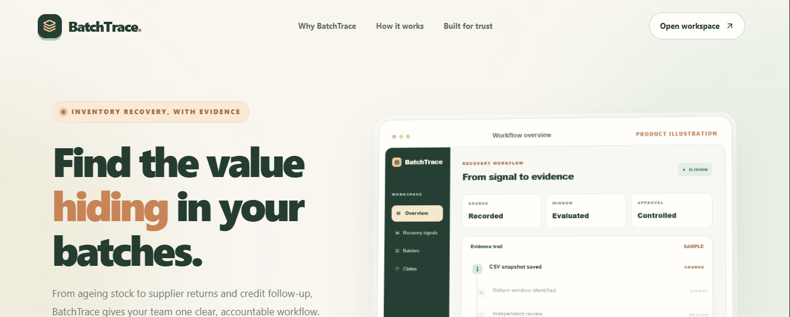
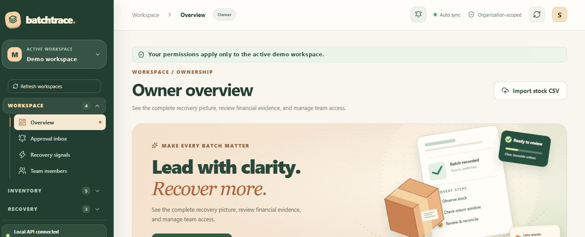
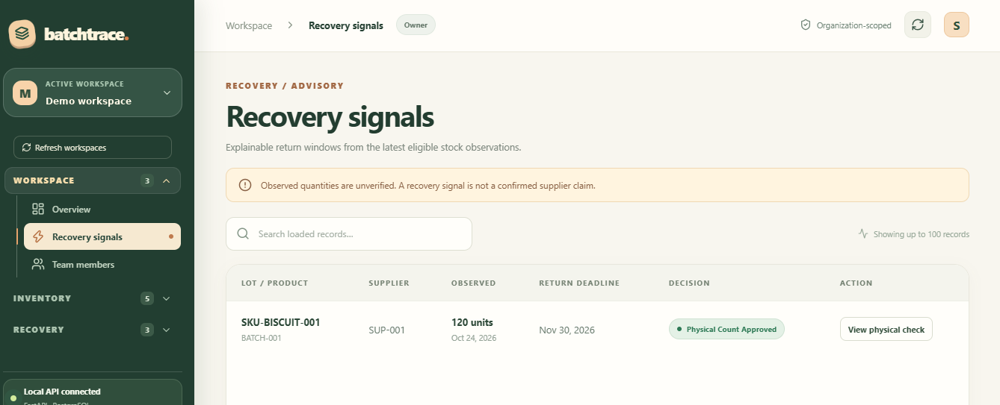
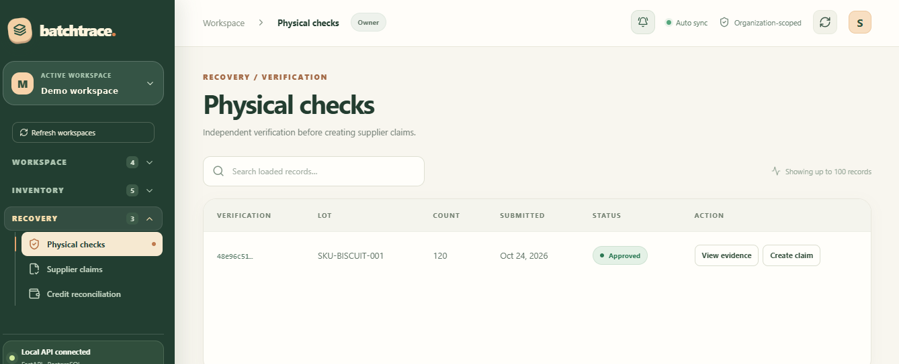
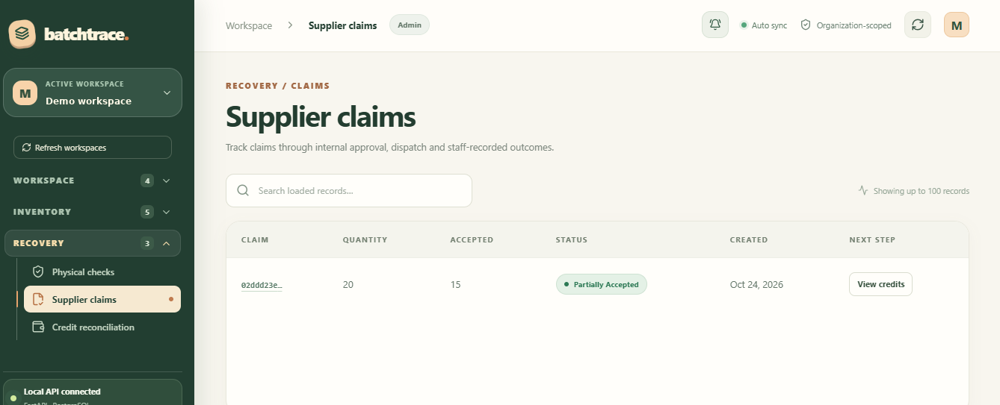
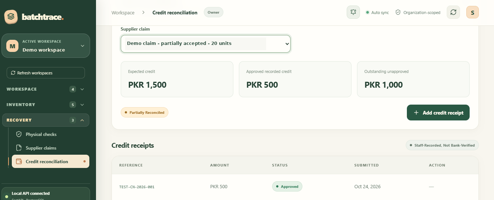
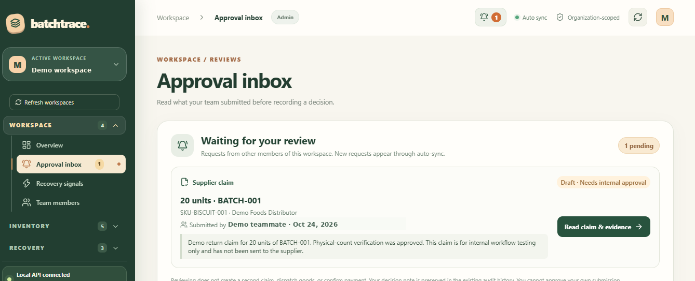
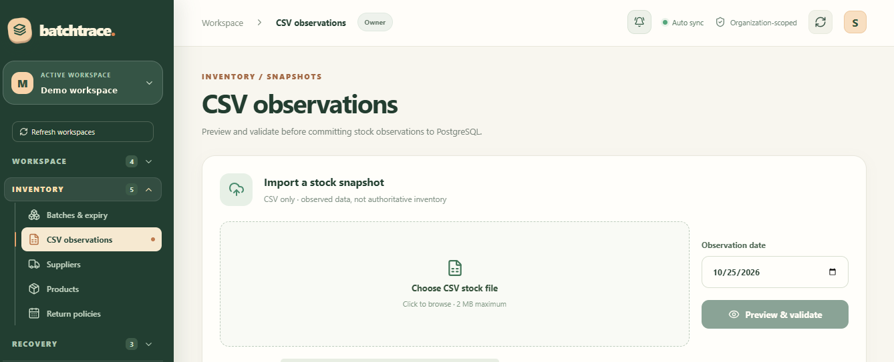
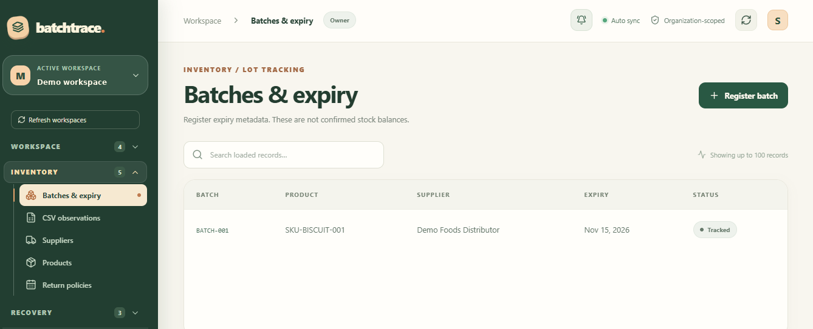
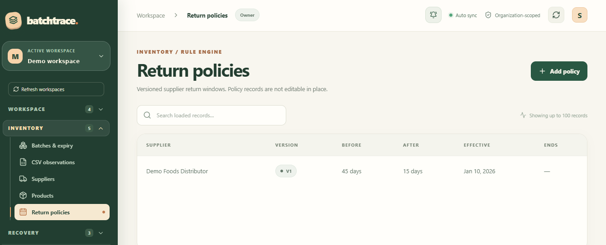

<div align="center">

# BatchTrace

### Trace inventory risk. Document returns. Reconcile supplier credit.

A workspace-based, self-hostable platform for turning historical stock observations into explainable expiry-recovery workflows — from evidence gathering to internal credit reconciliation.

**FastAPI · PostgreSQL · React · TypeScript · Remotion**

**Free to self-host. No domain or paid account needed for a local install.**

[Start here: free installation & user guide](docs/USER_GUIDE.md) · [Contributing](CONTRIBUTING.md) · [Security](SECURITY.md) · [MIT License](LICENSE)

[](https://github.com/mudassirejaz-art/batchtrace/actions/workflows/frontend-ci.yml) [](https://github.com/mudassirejaz-art/batchtrace/actions/workflows/backend-ci.yml)

</div>

---

## Overview

BatchTrace helps teams identify batches approaching expiry, review the supporting evidence, coordinate supplier return claims, and keep a clear internal record of expected versus recorded credit.

It is built around **traceability and independent review**. Parsed CSV rows are saved as historical observations (the original uploaded CSV is not archived); supplier policies are versioned; decisions and claim events leave an audit trail.

> **Scope:** BatchTrace is an internal operational and reconciliation tool. It does not contact suppliers, verify bank payments, or automatically recover money. A recorded credit is not proof that funds have been received.

## What BatchTrace helps you manage

BatchTrace is a **free, open-source inventory expiry tracking
system** for teams managing product batches, supplier return
windows, and historical inventory evidence.

The application supports **batch and lot tracking**,
**expiry date monitoring**, **CSV stock snapshot imports**,
and **supplier return policy management**. These workflows
help teams identify potentially recoverable stock and
maintain a traceable inventory audit trail.

BatchTrace also supports **physical stock verification**,
**independent approvals**, **supplier return claims**,
and **internal supplier credit reconciliation**.

Built with **FastAPI, React, TypeScript, and PostgreSQL**,
BatchTrace is a self-hosted inventory recovery application.
It does not automatically contact suppliers, verify bank
payments, or maintain authoritative live stock balances.

## How it works

```text
Stock CSV observations
        |
        v
Lots + supplier policy history
        |
        v
Expiry / return opportunity signals
        |
        v
Physical verification + independent approval
        |
        v
Return claim -> dispatch -> supplier outcome
        |
        v
Expected credit -> receipt evidence -> independent review
        |
        v
Internal outstanding-credit reconciliation
```

## Features

| Area | What BatchTrace supports |
| --- | --- |
| Workspaces and teams | Organization-scoped memberships and owner, admin, staff, and viewer permissions |
| Product catalog | Suppliers, products, lots, expiration dates, and workspace-specific records |
| Policy history | Versioned supplier return policies with effective-date tracking |
| Stock imports | CSV preview, validation, commit, idempotency checks, and historical snapshot evidence |
| Recovery signals | Explainable expiry/return statuses with source provenance and filters |
| Physical verification | Submitted counts, evidence and independent review; original imported observations remain unchanged |
| Supplier return claims | Draft, approval, dispatch, supplier outcome, allocation controls and event history |
| Credit reconciliation | Internal expected-credit terms, receipt evidence, reviewer decisions and outstanding balances |
| Dashboard | Recovery views, approval inbox, claim details, evidence viewer and team workflows |
| Public landing page | Responsive landing experience with Remotion-powered motion |

## Product screenshots

*Real BatchTrace UI captured from an isolated local demo workspace. Browser controls, Windows taskbar and account identifiers have been cropped or redacted. Screenshots show sample records, not live inventory or verified bank payments.*

### Landing and dashboard





### From expiry signals to supplier credit

| Recovery signals | Physical verification |
| --- | --- |
|  |  |

| Supplier claims | Credit reconciliation |
| --- | --- |
|  |  |

### Other product screens

| Approval inbox | CSV stock observations |
| --- | --- |
| [](docs/screenshots/07-approval-inbox.png) | [](docs/screenshots/08-csv-observations.png) |

| Batches & expiry | Supplier return policies |
| --- | --- |
| [](docs/screenshots/09-batches-expiry.png) | [](docs/screenshots/12-return-policies.png) |

Additional captured views: [Supplier directory](docs/screenshots/10-suppliers.png) · [Product catalog](docs/screenshots/11-products.png) · [Register batch form](docs/screenshots/13-register-batch.png)

## Application routes

| URL | Purpose |
| --- | --- |
| `/` | Public landing page |
| `/app` | Login and authenticated dashboard |
| `/api/v1/health` | API health endpoint |
| `/docs` | Interactive API documentation in development mode only |

The Vite development server proxies API requests to the FastAPI backend. The deployment skeleton uses Caddy to serve the frontend and reverse-proxy `/api` to the backend.

## Architecture

```text
Browser
  |
  +-- React / TypeScript (Vite)
  |     +-- Landing page + Remotion motion
  |     +-- Authenticated workflow dashboard
  |
  +-- /api/v1/* -> FastAPI
                      |
                      +-- Authentication / workspace RBAC
                      +-- Catalog / imports / recovery
                      +-- Verifications / claims / credit reviews
                      |
                      +-- Async SQLAlchemy -> PostgreSQL
```

**Repository layout**

```text
backend/       FastAPI application, Alembic migrations, smoke scripts
frontend/      React + TypeScript application and landing experience
deployment/    Docker Compose, Caddy, Dockerfiles and deployment guide
```

## Local development

**Prerequisites:** Python 3.12, Node.js 22, npm, and PostgreSQL 16. This project has been developed and tested using Ubuntu WSL. Docker is **not required** for local development.

### 1. Backend

```bash
cd backend
python3 -m venv .venv
source .venv/bin/activate
pip install -r requirements.txt
```

Configure a **local development database** and the required environment settings in `backend/.env` (including `DATABASE_URL` and `JWT_SECRET`). Use unique values; do not commit real `.env` files. Check `backend/app/core/config.py` for the authoritative current setting names.

**Database caution:** Run Alembic migrations only on a database that you explicitly intend to initialize or upgrade; never aim this command at production or an existing important database without review and backup.

```bash
# On an approved local development database only:
alembic upgrade head

uvicorn app.main:app --reload --host 127.0.0.1 --port 8000
```

### 2. Frontend

In another terminal:

```bash
cd frontend
npm ci
npm run dev
```

Open `http://127.0.0.1:5173/` for the landing page and `http://127.0.0.1:5173/app` for the application.

### 3. Frontend checks

```bash
cd frontend
npm run build
npm run lint
```

## Test coverage and validation

The project includes **12 standalone backend integration smoke scripts**, covering authentication, catalog, lots, supplier policies, imports, recovery, verifications, claims, settlements, login throttling, role enforcement and team membership.

```bash
cd backend
source .venv/bin/activate

# WARNING: These smoke scripts create test records in the configured DB.
# Run only against an explicitly verified local test database.
for name in \
  auth catalog lots return_policies imports recovery \
  verifications claims settlements login_throttle roles team
do
  PYTHONPATH="$PWD:$PWD/tests" python "tests/smoke_${name}.py" || exit 1
done
```

**Last recorded local validation (October 25, 2026):** 12/12 backend smoke scripts passed; 5/5 post-patch browser acceptance checks passed; the frontend production build passed; lint completed with 0 errors and 1 formatting/minification warning. A local PostgreSQL backup was restored to an isolated database and its migration and sample reconciliation evidence were verified.

These results describe **local validation**, not a production uptime, penetration-test, or deployment certification.

## Security model

- JWT authentication and password hashing
- Workspace-bound authorization and role checks
- Independent approval requirements for protected decisions
- Immutable or append-only evidence/event workflows where applicable
- Login throttling and idempotency controls for selected writes
- Production-mode API documentation disabled; configurable CORS and response security headers
- Local backup restore drill completed

Security hardening remains ongoing. Do not expose a production instance without validating TLS, secret management, reverse-proxy behavior, monitoring, incident response, retention, off-site backups and a production restore drill.

## Deployment

A **single-VPS deployment skeleton** is included in [`deployment/`](deployment/) using:

- Caddy for HTTPS, static frontend and `/api` proxy
- FastAPI/Uvicorn behind the reverse proxy
- PostgreSQL 16 on a private Compose network and persistent volume

See [`deployment/README.md`](deployment/README.md) for prerequisite and approval gates. Container build/run, real DNS/TLS setup and production backup validation are **not yet verified**. Do not run database migrations against production without explicit review and approval.

## Project status

**Development release candidate.** Core workflows, landing page, local integration checks, browser acceptance and isolated backup restore have been validated. Public hosting, operational runbooks and external security reviews are separate milestones.

## License and contributions

**Open source — MIT License.** You may use, modify, and redistribute the code, including commercially, subject to [LICENSE](LICENSE). See [USER GUIDE](docs/USER_GUIDE.md) for free local setup and operational workflow, [CONTRIBUTING](CONTRIBUTING.md) for contributions, and [SECURITY](SECURITY.md) for security reporting. Third-party dependencies/assets are governed by their own licenses.

**No hosted service is provided:** users must run BatchTrace on their own computer or server. The current source is a development release candidate, not a security-certified or production-operated service.

---

<div align="center">

**BatchTrace — Know what's expiring. Know what's recoverable. Know what's recorded.**

</div>
